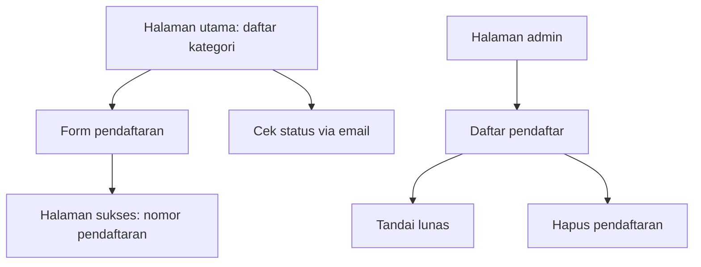
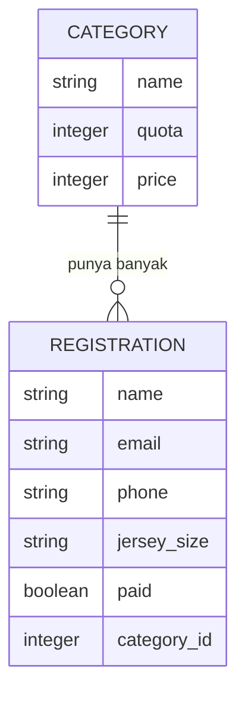

# Pendaftaran Maraton - Plan

## Goal Capsule

- **Objective.** Membangun sistem pendaftaran lari yang sederhana sebagai proyek belajar Ruby on Rails dan Tailwind.
- **Product authority.** Ini proyek latihan, bukan sistem untuk event sungguhan. Ketika ada pilihan antara fitur yang mengesankan dan fitur yang mengajarkan dasar Rails, pilih yang mengajarkan.
- **Stop conditions.** Berhenti dan tanya bila sebuah unit menuntut gem tambahan, layanan pihak ketiga, atau perubahan pada batas cakupan di Product Contract.
- **Execution profile.** Kerjakan unit berurutan U1 sampai U6. Setiap unit menambah satu kemampuan yang bisa dilihat di browser.
- **Tail ownership.** Deploy ke VPS Biznet bukan bagian rencana ini. Kerangka Kamal sudah tergenerate dan menunggu pekerjaan terpisah setelah aplikasi berjalan di komputer sendiri.
- **Open blockers.** Tidak ada.

---

## Product Contract

### Summary

Aplikasi web satu halaman pendaftaran: pengunjung memilih kategori lomba yang masih punya kuota, mengisi data diri, dan mendapat nomor pendaftaran. Panitia membuka halaman admin sederhana untuk melihat daftar pendaftar, menandai siapa yang sudah membayar, dan menghapus pendaftaran yang batal. Pembayaran terjadi di luar aplikasi.

### Problem Frame

Tujuan proyek ini adalah belajar, bukan menyelesaikan masalah panitia event.

Pendaftaran lari dipilih sebagai bahan latihan karena ukurannya pas: ada dua entitas yang saling berhubungan, ada aturan yang harus divalidasi, ada satu halaman publik dan satu halaman admin. Itu cukup untuk menyentuh hampir semua dasar Rails — model, migrasi, validasi, relasi, controller RESTful, form, dan view — tanpa membutuhkan layanan pihak ketiga.

Risiko terbesar proyek belajar bukan kurang fitur, melainkan terlalu banyak fitur. Integrasi pembayaran, background job, dan upload berkas akan menghabiskan waktu untuk hal yang belum saatnya dipelajari, dan menyembunyikan dasar yang justru sedang dilatih.

### Target user

- Pengunjung yang ingin ikut lomba. Membuka aplikasi dari ponsel, mengisi form sekali, tidak membuat akun.
- Panitia. Satu orang, memegang kata sandi admin, membuka daftar pendaftar dari laptop.

### User journey

- F1. **Mendaftar.** Pengunjung membuka halaman utama, melihat daftar kategori beserta sisa kuota, memilih satu kategori, mengisi data diri, dan mengirim form. Ia langsung melihat halaman berisi nomor pendaftaran dan informasi cara membayar.
- F2. **Mengecek status.** Pengunjung kembali beberapa hari kemudian, memasukkan alamat email yang dipakai mendaftar, dan melihat status pendaftarannya.
- F3. **Mengelola pendaftaran.** Panitia masuk ke halaman admin, melihat seluruh pendaftar dan sisa kuota tiap kategori, menandai pendaftaran yang uang transfernya sudah masuk sebagai lunas, dan menghapus pendaftaran yang batal agar slotnya kembali tersedia.

### Requirements

**Pendaftaran publik**

- R1. Pengunjung menyelesaikan pendaftaran tanpa membuat akun.
- R2. Pengunjung mendaftar melalui satu form berisi nama, email, nomor ponsel, kategori, dan ukuran jersey.
- R3. Form menolak pengiriman bila ada field wajib yang kosong atau format email tidak valid, dan menampilkan pesan kesalahan di sebelah field yang bermasalah.
- R4. Satu alamat email hanya boleh dipakai untuk satu pendaftaran.
- R6. Setelah berhasil mendaftar, pengunjung melihat halaman berisi nomor pendaftaran dan petunjuk pembayaran.
- R7. Pengunjung dapat melihat status pendaftarannya dengan memasukkan alamat email yang dipakai mendaftar.

**Kuota**

- R5. Kategori yang kuotanya sudah penuh tidak dapat dipilih.
- R12. Sisa kuota kategori dihitung dari seluruh pendaftaran pada kategori itu, tanpa membedakan yang sudah lunas dan yang belum.

**Halaman admin**

- R8. Halaman admin dilindungi kata sandi tunggal yang tidak ditulis di dalam kode.
- R9. Panitia melihat daftar seluruh pendaftar beserta statusnya dan sisa kuota tiap kategori.
- R10. Panitia dapat mengubah status sebuah pendaftaran antara belum lunas dan lunas.
- R13. Panitia dapat menghapus sebuah pendaftaran, dan slot kategorinya kembali tersedia.

**Tampilan**

- R11. Seluruh halaman dapat digunakan dengan nyaman dari layar ponsel.

### Acceptance Examples

- AE1. **Covers R4.** Alamat `budi@example.com` sudah pernah mendaftar. Ketika alamat yang sama dikirim lagi, maka pendaftaran ditolak dan form menampilkan pesan bahwa email tersebut sudah terdaftar.
- AE2. **Covers R5, R12.** Kategori 5K berkuota 50 dan sudah punya 50 pendaftaran, sebagian belum lunas. Ketika pengunjung membuka halaman utama, maka kategori 5K tampil dengan sisa kuota nol dan tidak dapat dipilih.
- AE3. **Covers R7.** Seorang pendaftar berstatus belum lunas. Ketika ia memasukkan alamat emailnya di halaman cek status, maka ia melihat nama, kategori, nomor pendaftaran, dan keterangan bahwa pembayarannya belum tercatat.
- AE4. **Covers R13.** Kategori 10K berkuota 30 dan sudah penuh. Ketika panitia menghapus satu pendaftaran, maka sisa kuota 10K menjadi satu dan kategori itu dapat dipilih lagi.

### Scope Boundaries

**Ditunda untuk versi berikutnya**

- Unggah bukti transfer oleh pendaftar.
- Pengiriman email konfirmasi otomatis.
- Ekspor daftar pendaftar ke berkas.
- Penomoran BIB otomatis.
- Lebih dari satu event dalam satu aplikasi.
- Antarmuka admin untuk menambah dan mengubah kategori. Kategori diisi lewat seed pada versi ini, per KTD4.

**Di luar cakupan versi pertama**

- Pembayaran online dan integrasi payment gateway. Pembayaran terjadi lewat transfer bank di luar aplikasi.
- Akun dan login untuk pendaftar. Identitas cukup dibawa oleh alamat email.
- Pembatalan otomatis pendaftaran yang tidak dibayar dalam tenggat tertentu.
- Daftar tunggu untuk kategori yang penuh.
- QR code, e-ticket, dan pencatatan pengambilan race pack.
- Hasil lomba, waktu finish, dan ranking.

**Ditunda ke pekerjaan lanjutan**

- Deploy ke VPS Biznet dengan Kamal. Berkas `config/deploy.yml`, `.kamal/secrets`, dan `Dockerfile` sudah tergenerate tapi belum diisi dan belum diuji. Kerjakan setelah kriteria sukses di bawah terpenuhi.

### Success Criteria

- Aplikasi berjalan di komputer sendiri dan dapat dipakai mendaftar dari ponsel di jaringan yang sama.
- Dua puluh pendaftaran percobaan masuk tanpa error, dan jumlah pendaftar tidak pernah melampaui kuota kategori.
- Setiap file yang dibuat dapat dijelaskan sendiri fungsinya tanpa melihat catatan.
- Tidak ada gem tambahan di luar bawaan Rails dan Tailwind.

### Dependencies / Assumptions

- Versi pertama memakai dua kategori: 5K berkuota 50 dan 10K berkuota 30. Kuota sengaja dibuat kecil agar aturan kuota penuh mudah diuji tanpa banyak data percobaan.
- Nomor pendaftaran diasumsikan cukup berupa angka berurutan, bukan kode yang sulit ditebak, karena tidak ada yang dirahasiakan di baliknya.
- Kata sandi admin tunggal dianggap memadai karena aplikasi tidak berjalan di internet publik selama tahap ini.

### Outstanding Questions

**Deferred to Planning**

Tidak ada yang tersisa. Bentuk tabel dijawab oleh KTD1, penyimpanan kata sandi admin oleh KTD3, dan validasi kuota oleh KTD2.

---

## Planning Contract

**Product Contract preservation.** Diubah: R5 dipecah — R5 mempertahankan maksud aslinya, dan R12 baru memegang dasar perhitungan kuota. R13 ditambahkan untuk penghapusan pendaftaran oleh panitia. Keduanya dikonfirmasi pengguna pada sesi ini. Requirement lain tidak berubah.

### Key Technical Decisions

- KTD1. **Dua model: `Category` dan `Registration`, dengan `Registration belongs_to :category`.** Ini jumlah entitas terkecil yang masih mengajarkan relasi satu-ke-banyak. Governs R1, R2, R5.
- KTD2. **Kuota divalidasi di model `Registration` lewat validasi kustom yang menghitung pendaftaran pada kategori tujuan.** Aturan bisnis tinggal di model, bukan di controller, sesuai konvensi Rails. Governs R5, R12.
- KTD3. **Halaman admin memakai `http_basic_authenticate_with` bawaan Rails, dengan kata sandi dari Rails credentials.** Tidak ada gem autentikasi. Governs R8.
- KTD4. **Kategori diisi lewat `db/seeds.rb`, bukan antarmuka admin.** Menghemat satu CRUD penuh yang tidak menambah pelajaran baru di tahap ini.
- KTD5. **Nomor pendaftaran memakai `id` record apa adanya.** Tidak ada kode acak, karena tidak ada yang dirahasiakan di balik nomor itu. Governs R6.
- KTD6. **Cek status memakai form pencarian berdasarkan email, bukan tautan unik per pendaftar.** Menghindari pengiriman email yang belum masuk cakupan. Governs R7.
- KTD7. **Tes memakai minitest bawaan Rails.** Tidak ada RSpec, tidak ada FactoryBot; fixture bawaan sudah cukup.
- KTD8. **Nama model, tabel, controller, dan rute memakai bahasa Inggris; bahasa Indonesia hanya pada teks yang dilihat pengguna.** Pluralisasi otomatis Rails hanya mengenal bahasa Inggris, sehingga nama seperti `Pendaftaran` menghasilkan tabel dan helper yang kacau.
- KTD9. **Menandai lunas memakai dua rute anggota terpisah, bukan satu rute pengalih.** Dua aksi dengan maksud eksplisit lebih mudah dibaca pemula daripada satu aksi yang membalik nilai. Governs R10.

### High-Level Technical Design

Bentuk data:

Peta rute:

| Path | Controller#action | Untuk |
|---|---|---|
| `GET /` | `categories#index` | Info event dan daftar kategori dengan sisa kuota |
| `GET /registrations/new` | `registrations#new` | Form pendaftaran |
| `POST /registrations` | `registrations#create` | Menyimpan pendaftaran |
| `GET /registrations/:id` | `registrations#show` | Halaman sukses berisi nomor pendaftaran |
| `GET /status` | `status#show` | Form cek status, sekaligus menampilkan hasil bila ada parameter email |
| `GET /admin/registrations` | `admin/registrations#index` | Daftar pendaftar dan sisa kuota |
| `PATCH /admin/registrations/:id/mark_paid` | `admin/registrations#mark_paid` | Menandai lunas |
| `PATCH /admin/registrations/:id/mark_unpaid` | `admin/registrations#mark_unpaid` | Membatalkan tanda lunas |
| `DELETE /admin/registrations/:id` | `admin/registrations#destroy` | Menghapus pendaftaran |

### Assumptions

- Validasi kuota di tingkat model tidak kebal terhadap dua pendaftaran yang masuk pada saat yang sama persis. Pada skala di bawah 300 peserta dengan pendaftaran yang tidak meledak serentak, risikonya diterima. Kunci di tingkat basis data adalah pekerjaan lanjutan bila kelak dibutuhkan.
- Halaman sukses dan halaman cek status hanya menampilkan nama, kategori, nomor, dan status — bukan email atau nomor ponsel — sehingga nomor pendaftaran yang mudah ditebak tidak membocorkan kontak peserta.

---

## Implementation Units

### U1. Model Category dan Registration

- **Goal:** Bentuk data dan seluruh aturan validasinya berdiri, termasuk kuota dan email unik.
- **Requirements:** R2, R3, R4, R5, R12
- **Dependencies:** tidak ada
- **Files:**
  - `app/models/category.rb`
  - `app/models/registration.rb`
  - `db/migrate/` (dua migrasi: `create_categories`, `create_registrations`)
  - `db/seeds.rb`
  - `test/models/category_test.rb`
  - `test/models/registration_test.rb`
  - `test/fixtures/categories.yml`
  - `test/fixtures/registrations.yml`
- **Approach:**
  1. Buat migrasi `categories` dengan `name`, `quota`, `price`, dan indeks unik pada `name`.
  2. Buat migrasi `registrations` dengan `name`, `email`, `phone`, `jersey_size`, `paid` (default `false`, `null: false`), dan `category` sebagai foreign key.
  3. Tambahkan indeks unik pada `registrations.email` sehingga R4 dijaga basis data, bukan hanya model.
  4. `Category has_many :registrations`; tambahkan metode sisa kuota dan metode penuh-atau-belum yang membaca jumlah pendaftaran, per KTD2.
  5. `Registration belongs_to :category`; validasi kehadiran seluruh field wajib, format email, keunikan email, dan validasi kustom yang menolak pendaftaran ketika kategori tujuan sudah penuh.
  6. Isi `db/seeds.rb` dengan dua kategori per KTD4, memakai `find_or_create_by` agar aman dijalankan ulang.
- **Patterns to follow:** Konvensi vanilla Rails dari skill `dhh-vibecoding:rails-conventions` — model gemuk, validasi di model, tanpa service object.
- **Test scenarios:**
  - Pendaftaran dengan seluruh field valid pada kategori yang masih kosong berhasil disimpan.
  - Pendaftaran tanpa nama ditolak, dan pesan kesalahan menempel pada atribut nama.
  - Pendaftaran dengan email berformat salah seperti `budi.example.com` ditolak.
  - Covers AE1. Pendaftaran kedua dengan email yang sudah terpakai ditolak dengan pesan bahwa email sudah terdaftar.
  - Covers AE2. Pada kategori berkuota dua yang sudah punya dua pendaftaran, pendaftaran ketiga ditolak — dan tetap ditolak ketika kedua pendaftaran yang ada berstatus belum lunas.
  - Sisa kuota kategori berkuota lima dengan dua pendaftaran bernilai tiga.
  - Covers AE4. Sisa kuota bertambah satu setelah salah satu pendaftaran dihapus.
  - Menjalankan seed dua kali tidak menghasilkan kategori ganda.
- **Verification:** `bin/rails test test/models` hijau, dan `bin/rails db:seed` menghasilkan dua kategori.

### U2. Halaman utama daftar kategori

- **Goal:** Pengunjung melihat informasi event dan kategori beserta sisa kuotanya, dengan kategori penuh yang tidak bisa dipilih.
- **Requirements:** R5, R12
- **Dependencies:** U1
- **Files:**
  - `config/routes.rb`
  - `app/controllers/categories_controller.rb`
  - `app/views/categories/index.html.erb`
  - `app/views/layouts/application.html.erb`
  - `test/controllers/categories_controller_test.rb`
- **Approach:**
  1. Set `root "categories#index"` dan daftarkan `resources :categories, only: [:index]`.
  2. Controller memuat seluruh kategori beserta jumlah pendaftarannya.
  3. View menampilkan tiap kategori sebagai kartu berisi nama, harga, sisa kuota, dan tombol daftar.
  4. Kategori yang penuh menampilkan label penuh, dan tombol daftarnya tidak ditampilkan.
- **Patterns to follow:** Kelas utilitas Tailwind langsung di ERB, tanpa berkas CSS terpisah, sesuai skill `dhh-vibecoding:tailwind-patterns`.
- **Test scenarios:**
  - Halaman utama merespons sukses dan memuat nama kedua kategori seed.
  - Kategori dengan sisa kuota nol menampilkan penanda penuh.
  - Kategori dengan sisa kuota nol tidak menampilkan tautan menuju form pendaftaran.
  - Kategori yang masih punya sisa menampilkan angka sisa kuota yang benar.
- **Verification:** Buka `http://localhost:3000` setelah `bin/dev`; kedua kategori tampil dengan sisa kuota yang benar.

### U3. Form pendaftaran dan halaman sukses

- **Goal:** Pengunjung dapat mendaftar dan menerima nomor pendaftaran.
- **Requirements:** R1, R2, R3, R4, R6
- **Dependencies:** U1, U2
- **Files:**
  - `config/routes.rb`
  - `app/controllers/registrations_controller.rb`
  - `app/views/registrations/new.html.erb`
  - `app/views/registrations/show.html.erb`
  - `test/controllers/registrations_controller_test.rb`
- **Approach:**
  1. Daftarkan `resources :registrations, only: [:new, :create, :show]`.
  2. `new` menyiapkan objek pendaftaran kosong; kategori yang datang lewat parameter dipilih lebih dulu di form.
  3. Form memakai `form_with` dan menampilkan kesalahan validasi di sebelah tiap field, per R3.
  4. Pilihan kategori pada form hanya memuat kategori yang belum penuh, per R5.
  5. `create` menyimpan lalu mengalihkan ke halaman sukses; kegagalan validasi merender ulang form dengan status `:unprocessable_entity`.
  6. Halaman sukses menampilkan nomor pendaftaran, nama, kategori, dan petunjuk transfer — tanpa email dan nomor ponsel, sesuai asumsi di Planning Contract.
- **Patterns to follow:** Controller ramping dengan strong parameters; tanpa logika bisnis di controller.
- **Test scenarios:**
  - Membuka form pendaftaran merespons sukses dan menampilkan seluruh field wajib.
  - Mengirim data valid menambah satu pendaftaran dan mengalihkan ke halaman sukses.
  - Halaman sukses memuat nomor pendaftaran yang sama dengan id pendaftaran yang baru dibuat.
  - Mengirim form tanpa nama tidak menambah pendaftaran dan merender ulang form dengan pesan kesalahan.
  - Covers AE1. Mengirim email yang sudah terdaftar tidak menambah pendaftaran dan menampilkan pesan bahwa email sudah terpakai.
  - Mengirim pendaftaran untuk kategori yang sudah penuh tidak menambah pendaftaran.
  - Daftar pilihan kategori pada form tidak memuat kategori yang penuh.
  - Halaman sukses tidak memuat alamat email pendaftar.
- **Verification:** Daftar dari browser sampai muncul nomor pendaftaran; kirim ulang dengan email yang sama dan pastikan ditolak.

### U4. Cek status pendaftaran

- **Goal:** Pengunjung dapat memeriksa status pendaftarannya sendiri lewat alamat email.
- **Requirements:** R7
- **Dependencies:** U1, U3
- **Files:**
  - `config/routes.rb`
  - `app/controllers/status_controller.rb`
  - `app/views/status/show.html.erb`
  - `test/controllers/status_controller_test.rb`
- **Approach:**
  1. Daftarkan `get "status", to: "status#show"`.
  2. Tanpa parameter email, halaman hanya menampilkan form pencarian.
  3. Dengan parameter email, controller mencari pendaftaran yang cocok dan view menampilkan hasilnya, per KTD6.
  4. Email yang tidak ditemukan menghasilkan pesan ramah, bukan halaman kesalahan.
  5. Hasil menampilkan nama, kategori, nomor pendaftaran, dan status pembayaran saja.
- **Patterns to follow:** Satu aksi dengan dua keadaan tampilan; pencarian memakai `GET` karena tidak mengubah data.
- **Test scenarios:**
  - Membuka halaman status tanpa parameter merespons sukses dan menampilkan form pencarian.
  - Covers AE3. Mencari email milik pendaftar yang belum lunas menampilkan nama, kategori, nomor, dan keterangan belum lunas.
  - Mencari email milik pendaftar yang sudah lunas menampilkan keterangan lunas.
  - Mencari email yang tidak terdaftar menampilkan pesan tidak ditemukan dan tetap merespons sukses.
  - Halaman hasil tidak memuat nomor ponsel pendaftar.
- **Verification:** Cari email yang baru didaftarkan di U3 dan pastikan statusnya muncul.

### U5. Halaman admin

- **Goal:** Panitia dapat melihat seluruh pendaftar, menandai lunas, dan menghapus pendaftaran, di balik kata sandi.
- **Requirements:** R8, R9, R10, R13
- **Dependencies:** U1, U3
- **Files:**
  - `config/routes.rb`
  - `app/controllers/admin/registrations_controller.rb`
  - `app/views/admin/registrations/index.html.erb`
  - `config/credentials.yml.enc`
  - `test/controllers/admin/registrations_controller_test.rb`
- **Approach:**
  1. Daftarkan namespace `admin` berisi `resources :registrations, only: [:index, :destroy]` dengan dua rute anggota `mark_paid` dan `mark_unpaid`, per KTD9.
  2. Controller memanggil `http_basic_authenticate_with` yang membaca nama pengguna dan kata sandi dari Rails credentials, per KTD3.
  3. `index` menampilkan tabel pendaftar beserta kategori dan status, ditambah ringkasan sisa kuota tiap kategori.
  4. `mark_paid` dan `mark_unpaid` mengubah kolom status lalu kembali ke daftar.
  5. `destroy` menghapus pendaftaran lalu kembali ke daftar; tombol hapus meminta konfirmasi lebih dulu.
- **Execution note:** Simpan kata sandi lebih dulu lewat `bin/rails credentials:edit`. Di Windows, jalankan `$env:EDITOR="notepad"` pada sesi terminal yang sama sebelum perintah itu, karena tanpa editor yang ditunjuk perintahnya gagal.
- **Patterns to follow:** Autentikasi bawaan Rails tanpa gem; namespace `admin` memisahkan controller publik dan panitia.
- **Test scenarios:**
  - Membuka daftar admin tanpa kredensial menghasilkan status tidak terotorisasi.
  - Membuka daftar admin dengan kredensial benar merespons sukses dan memuat nama pendaftar yang ada.
  - Menandai sebuah pendaftaran lunas mengubah statusnya menjadi lunas.
  - Menandai ulang pendaftaran yang lunas sebagai belum lunas mengembalikan statusnya.
  - Menghapus pendaftaran mengurangi jumlah pendaftaran satu.
  - Covers AE4. Menghapus pendaftaran pada kategori yang penuh membuat kategori itu punya sisa kuota satu.
  - Menghapus pendaftaran tanpa kredensial tidak mengubah jumlah pendaftaran.
- **Verification:** Masuk ke `/admin/registrations` dengan kata sandi, tandai satu pendaftaran lunas, lalu hapus satu pendaftaran dan lihat sisa kuota di halaman utama bertambah.

### U6. Rapikan tampilan untuk ponsel

- **Goal:** Seluruh halaman nyaman dipakai dari layar ponsel.
- **Requirements:** R11
- **Dependencies:** U2, U3, U4, U5
- **Files:**
  - `app/views/layouts/application.html.erb`
  - `app/views/categories/index.html.erb`
  - `app/views/registrations/new.html.erb`
  - `app/views/registrations/show.html.erb`
  - `app/views/status/show.html.erb`
  - `app/views/admin/registrations/index.html.erb`
- **Approach:**
  1. Pastikan layout memuat meta viewport dan lebar konten yang terbatas dan terpusat.
  2. Susun kartu kategori satu kolom di layar kecil dan beberapa kolom di layar lebar.
  3. Beri field form tinggi sentuh yang memadai dan label yang terbaca.
  4. Buat tabel admin dapat digulir mendatar di layar sempit agar kolomnya tidak terpotong.
  5. Tambahkan navigasi sederhana ke halaman utama dan cek status.
- **Patterns to follow:** Pendekatan mobile-first dari skill `dhh-vibecoding:tailwind-patterns` — kelas dasar untuk layar kecil, `sm:` dan `md:` untuk memperlebar.
- **Test scenarios:** `Test expectation: none -- unit ini hanya mengubah tampilan dan tidak menambah perilaku baru.` Pembuktiannya lewat pemeriksaan manual di Verification.
- **Verification:** Buka setiap halaman dari ponsel di jaringan yang sama, atau dari mode perangkat di peramban pada lebar 375 piksel. Badan halaman tidak boleh bergulir mendatar, dan seluruh tombol dapat ditekan. Gulir mendatar di dalam pembungkus tabel admin adalah perilaku yang diinginkan pada langkah 4 dan tidak dihitung sebagai kegagalan.

---

## Verification Contract

| Gerbang | Perintah | Berlaku untuk |
|---|---|---|
| Tes otomatis | `bin/rails test` | U1 sampai U5 |
| Gaya kode | `bin/rubocop` | Semua unit |
| Pemeriksaan keamanan | `bin/brakeman` | U3, U5 |
| Jalankan aplikasi | `bin/dev` | Semua unit |
| Muat ulang basis data | `bin/rails db:reset` | U1 |

Pemeriksaan manual yang menutup kriteria sukses: masukkan dua puluh pendaftaran percobaan pada kategori berkuota kecil, pastikan pendaftaran melewati kuota selalu ditolak, lalu buka seluruh halaman dari ponsel.

---

## Definition of Done

**Global**

- Seluruh requirement R1 sampai R13 terpenuhi dan dapat ditunjukkan di browser.
- `bin/rails test`, `bin/rubocop`, dan `bin/brakeman` bersih.
- Tidak ada gem baru di `Gemfile` di luar bawaan Rails dan Tailwind.
- Kata sandi admin tersimpan di Rails credentials dan tidak muncul di berkas mana pun yang masuk git.
- Kode percobaan yang tidak jadi dipakai sudah dihapus, bukan ditinggalkan dalam keadaan dikomentari.

**Per unit**

- U1 — kedua model punya validasi lengkap dan seluruh tes model hijau; `bin/rails db:seed` menghasilkan dua kategori.
- U2 — halaman utama menampilkan sisa kuota yang benar dan menyembunyikan tombol daftar pada kategori penuh.
- U3 — pendaftaran berhasil menghasilkan nomor, dan email ganda serta kategori penuh sama-sama ditolak.
- U4 — pencarian email menampilkan status yang benar, dan email tak dikenal menghasilkan pesan ramah.
- U5 — halaman admin terkunci kata sandi; menandai lunas dan menghapus keduanya bekerja dan memengaruhi sisa kuota.
- U6 — seluruh halaman terpakai nyaman pada lebar 375 piksel tanpa gulir mendatar pada badan halaman; gulir di dalam pembungkus tabel admin dikecualikan.
